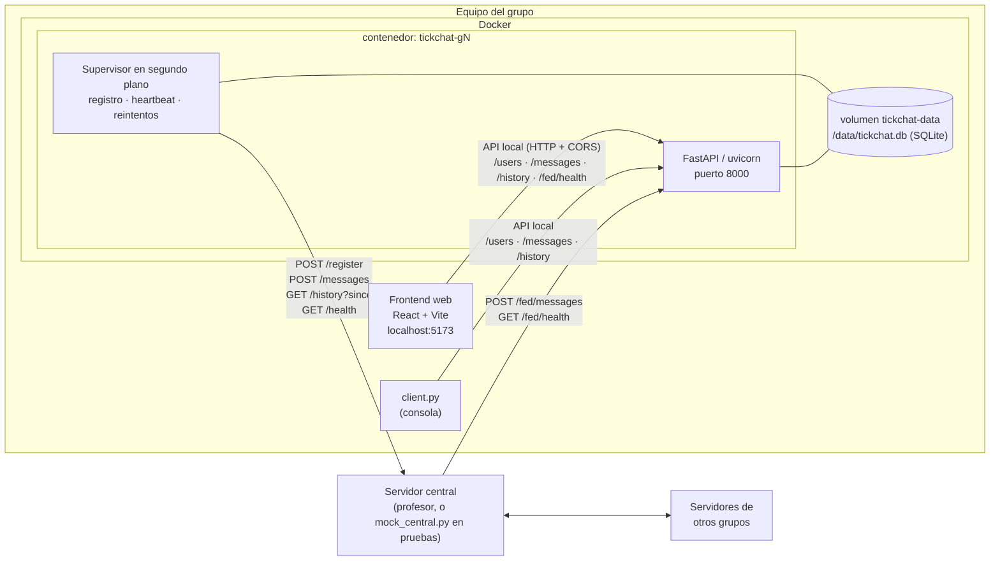

# tick-chat

Servidor de grupo para el chat distribuido del curso **Sistemas Distribuidos** (UIS · EISI).
Cada grupo levanta un servidor que se registra en el **servidor central** del profesor; por medio de él,
los usuarios de todos los grupos conversan en una sola sala global: `#general`.

- Servidor: Python + FastAPI, SQLite en un volumen de Docker.
- Clientes (solo hablan con nuestro servidor):
  - **Frontend web** (`frontend/`): React + Vite + Tailwind.
  - **Cliente de consola** (`client.py`): sin dependencias, corre también dentro del contenedor.
- Despliegue del servidor: `docker compose up`.
- Pruebas locales: servidor central simulado (`mock_central.py`) y experimento (`experiment/`).

---

## Arquitectura



| Elemento | Qué es |
|---|---|
| Contenedor `tickchat-gN` | Imagen `tick-chat-server` (Python 3.12 slim) que corre `uvicorn app.main:app` en el puerto 8000. |
| Volumen `tickchat-data` | Montado en `/data`. Guarda `tickchat.db` (usuarios, historial y reloj de Lamport). Sobrevive a `restart` y a `down`. |
| Red | La red por defecto de Compose. El puerto 8000 del contenedor se publica en `HOST_PORT` del equipo para que el central y los clientes lleguen a él. |
| `host.docker.internal` | Permite que el contenedor alcance servicios del equipo anfitrión (p. ej. `mock_central.py` en el puerto 9000). |
| Frontend web | Corre fuera de Docker con el servidor de desarrollo de Vite (puerto 5173) y llama a la API local en `http://localhost:8000`. El backend habilita CORS para permitirlo. |

Los servidores de grupo **nunca** se hablan directamente: todo pasa por el servidor central.
Los clientes (web y consola) **solo** hablan con nuestro servidor, nunca con el central.

### Estructura del repositorio

```
tick-chat/
├── app/                    # servidor de grupo (FastAPI)
│   ├── main.py             # arranque, CORS y tarea en segundo plano
│   ├── config.py           # lectura de variables de entorno y logs
│   ├── schemas.py          # formato de mensaje del protocolo
│   ├── database.py         # SQLite: usuarios, mensajes, reloj de Lamport
│   ├── routes_local.py     # API para los clientes
│   ├── routes_fed.py       # API que llama el servidor central (/fed/...)
│   └── federation.py       # registro, envío con backoff, heartbeat, historial
├── frontend/               # cliente web (React + Vite + Tailwind)
│   ├── src/
│   │   ├── App.jsx         # estado, consulta periódica y comandos (/history, /clear...)
│   │   ├── components/     # LoginModal, Sidebar, ChatWindow, MessageInput
│   │   └── services/api.js # llamadas HTTP a la API local
│   └── package.json
├── experiment/             # experimento del póster
│   ├── run_experiment.py   # automatiza las caídas y las mediciones
│   ├── plot_results.py     # genera la gráfica
│   ├── results.csv         # datos medidos
│   └── grafica.png / .pdf
├── mock_central.py         # servidor central simulado para pruebas locales
├── client.py               # cliente de consola
├── Dockerfile
├── docker-compose.yml
├── .env.example            # plantilla de configuración
└── requirements.txt
```

---

## Cómo levantarlo en un equipo limpio

Requisitos: **Docker** y **Docker Compose** (Docker Desktop en Windows/Mac). No hace falta instalar Python para el servidor.

```bash
git clone https://github.com/arcibyte/tick-chat.git
cd tick-chat

# 1. Crear la configuración a partir de la plantilla
cp .env.example .env        # en Windows: copy .env.example .env
#    y editar .env (GROUP_NAME, PUBLIC_URL, CENTRAL_URL)

# 2. Construir y levantar
docker compose up --build -d

# 3. Ver los logs (envíos, reintentos, descartes, heartbeat)
docker compose logs -f
```

Comprobar que responde:

```bash
curl http://localhost:8000/fed/health
# {"server":"g3","lamport":0}
```

---

## Clientes

### Frontend web

Requisitos: **Node.js 22 LTS o más reciente** (incluye `npm`; Vite no funciona con versiones viejas de Node). El servidor debe estar corriendo en `http://localhost:8000`.

```bash
# Desde la raíz del repositorio
npm install                 # instala @tailwindcss/postcss (ver nota abajo)

cd frontend
npm install                 # instala React, Vite y demás dependencias
npm run dev                 # servidor de desarrollo
```

Abrir **http://localhost:5173** en el navegador, escribir un nombre de usuario y entrar al chat.

> **Nota:** el plugin `@tailwindcss/postcss` que usa `frontend/postcss.config.js` está declarado en el
> `package.json` de la **raíz**, no en el de `frontend/`. Por eso hay que correr `npm install` en ambas
> carpetas; si solo se instala en `frontend/`, Vite falla al procesar el CSS.

Qué muestra la interfaz:

| Zona | Contenido |
|---|---|
| Barra lateral | Estado del servidor (**Online / Offline**, consultando `/fed/health`) y usuarios locales del grupo. |
| Sala `#general` | Mensajes ordenados por reloj de Lamport, cada uno con su etiqueta `Lamport [L42]`. Los mensajes propios salen a la derecha en morado; los demás, a la izquierda. |
| Actualización | La interfaz consulta `/history`, `/users` y `/fed/health` cada 2 segundos. |

Comandos que se escriben en la caja de mensaje:

| Comando | Acción |
|---|---|
| `/history` | Muestra el historial completo (JSON) en una consola flotante. |
| `/users` | Muestra los usuarios locales del servidor. |
| `/clear` o `/limpiar` | Limpia la vista local hasta la marca de Lamport actual. Solo afecta este navegador (se guarda en `localStorage`); no borra nada del servidor. |
| `/ayuda` o `/help` | Muestra la ayuda. |
| `/salir` o `/exit` | Cierra la sesión y vuelve a la pantalla de ingreso. |

Otros comandos de npm: `npm run build` genera la versión de producción en `frontend/dist/`; `npm run lint` revisa el código con ESLint.

### Cliente de consola

Desde el propio contenedor (no requiere nada más):

```bash
docker compose exec server python client.py
```

O desde el equipo, con Python 3 instalado (solo usa la librería estándar):

```bash
python client.py                            # http://localhost:8000
python client.py http://192.168.1.20:8000   # otro servidor
```

El cliente pide un nombre y crea el usuario `nombre@gN`. Los colores distinguen el origen de cada mensaje:

| Color | Quién |
|---|---|
| Amarillo | Mis propios mensajes |
| Verde | Otros usuarios de nuestro grupo |
| Cian | Usuarios de otros grupos |

Cada línea muestra la marca de Lamport, por ejemplo `[L42] ana@g2: hola`. Comandos: `/historial`, `/usuarios`, `/ayuda`, `/salir`.

### API local (la que usan ambos clientes)

| Método y ruta | Cuerpo / parámetros | Respuesta |
|---|---|---|
| `POST /users` | `{"username": "ana@g3"}` | `201` si se creó, `400` si ya existe |
| `GET /users` | — | `{"users": ["ana@g3", ...]}` |
| `POST /messages` | `{"from_user": "ana@g3", "body": "hola"}` | `201` con el mensaje creado; `404` si el usuario no existe |
| `GET /history` | `?since=<lamport>` (opcional) | `{"history": [...]}` ordenado por `(lamport, origin)` |
| `GET /fed/health` | — | `{"server": "g3", "lamport": 42}` |

---

## Comandos útiles de Docker

| Acción | Comando |
|---|---|
| Reiniciar (los datos se conservan) | `docker compose restart` |
| Apagar | `docker compose down` |
| Apagar **y borrar** la base de datos | `docker compose down -v` |
| Simular una caída abrupta | `docker kill tickchat-g3` |
| Reconstruir tras cambiar código | `docker compose up --build -d` |

---

## Variables de entorno

Se definen en `.env` (ver `.env.example`). Nada de esto está escrito en el código.

| Variable | Por defecto | Descripción |
|---|---|---|
| `GROUP_NAME` | `g1` | Nombre corto del grupo. Los usuarios quedan como `usuario@GROUP_NAME`. |
| `HOST_PORT` | `8000` | Puerto del equipo donde se publica el servidor. |
| `PUBLIC_URL` | `http://localhost:8000` | URL con la que el central nos contacta. En la sesión de clase debe ser `http://<IP-del-equipo>:<HOST_PORT>`. |
| `CENTRAL_URL` | `http://host.docker.internal:9000` | URL del servidor central. |
| `MAX_HEALTH_FAILURES` | `3` | Heartbeats fallidos seguidos para marcar el central como caído. |
| `HEARTBEAT_INTERVAL` | `5.0` | Segundos entre consultas a `GET /health` del central. |
| `REGISTER_INTERVAL` | `30.0` | Segundos entre renovaciones del registro. |
| `DB_PATH` | `/data/tickchat.db` | Fijada en `docker-compose.yml`; apunta al volumen. |

---

## Pruebas locales sin el servidor central del curso

`mock_central.py` imita al servidor central con la misma API del protocolo (`/register`, `/messages`,
`/history`, `/health`) y además tiene endpoints de control para el experimento:

| Endpoint | Efecto |
|---|---|
| `POST /_admin/down` | El central "se cae": todo responde `503`. |
| `POST /_admin/up` | El central se recupera. |
| `POST /_admin/reset` | Borra mensajes, registros y contadores. |
| `GET /_admin/stats` | Contadores y marcas de tiempo de cada mensaje. |

Pasos:

```bash
pip install -r requirements.txt
python mock_central.py              # puerto 9000 (otro: PORT=9100 python mock_central.py)
```

Con `FAIL_RATE=0.3 python mock_central.py` el central responde `503` al 30 % de los `POST /messages`, útil para ver los reintentos en los logs.

Luego, con `CENTRAL_URL=http://host.docker.internal:9000` en `.env`:

```bash
docker compose up --build -d
```

**Dos servidores en la misma máquina** (`g3a` y `g3b`), como recomienda el enunciado. Cree un archivo de configuración por servidor y use un nombre de proyecto distinto (`-p`) para que cada uno tenga su propio contenedor y su propio volumen:

```bash
# .env.g3a -> GROUP_NAME=g3a, HOST_PORT=8001, PUBLIC_URL=http://localhost:8001
# .env.g3b -> GROUP_NAME=g3b, HOST_PORT=8002, PUBLIC_URL=http://localhost:8002
docker compose -p g3a --env-file .env.g3a up --build -d
docker compose -p g3b --env-file .env.g3b up --build -d
```

---

## Experimento

**Pregunta:** cuando el servidor central se cae, ¿cuánto tarda en entregarse un lote de mensajes escritos
durante la caída una vez que el central vuelve, según cuánto duró la caída? ¿Se pierde o se duplica algún mensaje?

| | |
|---|---|
| Variable independiente | Duración de la caída del central: 0 (control), 2, 5, 10, 20 y 40 s |
| Variable dependiente | Tiempo de recuperación (s): última llegada al central − instante en que el central se recupera |
| Controles | 20 mensajes por corrida, heartbeat de 1 s, umbral de 3 fallos |
| Repeticiones | 3 por cada duración (18 corridas), cada una con central, servidor y base de datos nuevos |

Cómo se reproduce (desde la raíz, con las dependencias de `requirements.txt` instaladas):

```bash
python experiment/run_experiment.py                     # escribe experiment/results.csv
python experiment/run_experiment.py --durations 0 5 20 --reps 3 --messages 50
pip install matplotlib
python experiment/plot_results.py                       # genera experiment/grafica.png y .pdf
```

El script levanta `mock_central.py` y un servidor de grupo con `uvicorn` (sin Docker), provoca la caída con
`/_admin/down` y cuenta los mensajes entregados, perdidos y duplicados.

**Resultados** (`experiment/results.csv`, gráfica en `experiment/grafica.png`): en las 18 corridas llegaron
los 20 mensajes, **sin pérdidas ni duplicados**. El tiempo de recuperación se mantuvo entre 1,1 y 1,3 s
para caídas de 0 a 20 s (salvo una corrida de 20 s con 0,3 s) y bajó a 0,3–0,4 s en las tres caídas de 40 s.

> Según `experiment/HALLAZGOS_PARA_EL_EQUIPO.md`, el experimento se corrió sobre una copia del servidor con
> correcciones que aún no están en `main`.

---

## Decisiones de diseño

- **Un solo contenedor + SQLite en un volumen.** El enunciado permite SQLite; evita levantar un servicio de base de datos aparte y simplifica el despliegue. El volumen con nombre garantiza la persistencia ante `docker compose restart`.
- **Configuración solo por variables de entorno**, con una plantilla `.env.example` versionada y el `.env` real fuera de Git.
- **Logs sin buffer** (`PYTHONUNBUFFERED=1`) para que `docker compose logs` muestre cada evento al instante; son la base del experimento.
- **`HEALTHCHECK` en el Dockerfile** sobre `/fed/health`, así `docker ps` muestra si el servidor está sano.
- **Capas de la imagen ordenadas** (primero `requirements.txt`, luego el código) para que reconstruir tras un cambio de código sea rápido.
- **Dos clientes sobre la misma API local.** El enunciado pide "línea de comandos o página web mínima"; el frontend web es la interfaz principal para la demo y el cliente de consola sirve como respaldo, porque corre dentro del contenedor sin instalar Node.js.
- **CORS abierto en el backend** (`allow_origins=["*"]`) para que el frontend, servido desde otro puerto (5173), pueda llamar a la API local. Es adecuado para desarrollo y para la sesión de clase; en producción se limitaría al origen del frontend.
- **Frontend fuera de Docker.** Se ejecuta con el servidor de desarrollo de Vite; el requisito de `docker compose up` aplica al servidor y su almacenamiento.
- **Consulta periódica (polling) cada 2 s** en ambos clientes, en lugar de WebSockets: es más simple y suficiente para una sala de clase. El cliente de consola detecta mensajes nuevos por `id` (no por Lamport), porque un mensaje que llega tarde puede tener una marca menor que otros ya mostrados.
- **`/clear` solo local en el frontend:** guarda la marca de Lamport en `localStorage` y oculta los mensajes anteriores, sin tocar el historial del servidor (que es compartido y debe conservarse).
- **Los clientes solo hablan con nuestro servidor**; la API cliente–servidor es libre según el enunciado, la API con el central sigue la especificación.

---

## Limitaciones conocidas

- El frontend tiene la URL del servidor fija en `frontend/src/services/api.js` (`http://localhost:8000`) y el grupo `g1` escrito en la interfaz; para otro puerto u otro grupo hay que editarlos.
- El frontend registra el usuario sin el sufijo `@gN` (por ejemplo `jhon`), mientras que el cliente de consola usa `nombre@gN`.
- El frontend distingue los mensajes propios de los ajenos, pero todavía no colorea distinto a los usuarios de otros grupos; esa distinción (requisito 10) la hace el cliente de consola.

---

## Integrantes

| Rol | Responsable |
|---|---|
| Rol 1: Estructura base y federación | Jhon Arciniegas |
| Rol 2: Persistencia y servidor local | Ricardo Celis |
| Rol 3: Contenedores, cliente y documentación | Valentina Tarazona |
| Rol 4: Simulación, experimento y póster | Andres Caicedo |
