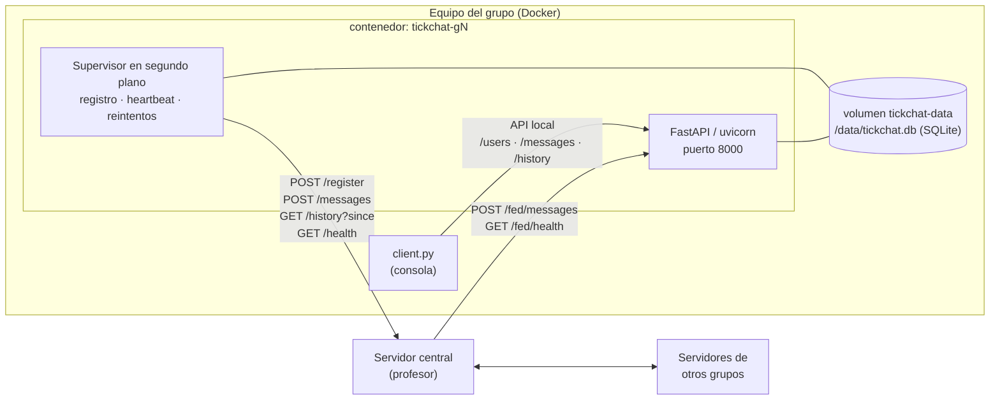

# tick-chat

Servidor de grupo para el chat distribuido del curso **Sistemas Distribuidos** (UIS · EISI).
Cada grupo levanta un servidor que se registra en el **servidor central** del profesor; por medio de él,
los usuarios de todos los grupos conversan en una sola sala global: `#general`.

- Servidor: Python + FastAPI, SQLite en un volumen de Docker.
- Cliente: aplicación de consola (`client.py`) que solo habla con nuestro servidor.
- Despliegue: `docker compose up`.

---

## Arquitectura



| Elemento | Qué es |
|---|---|
| Contenedor `tickchat-gN` | Imagen `tick-chat-server` (Python 3.12 slim) que corre `uvicorn app.main:app` en el puerto 8000. |
| Volumen `tickchat-data` | Montado en `/data`. Guarda `tickchat.db` (usuarios, historial y reloj de Lamport). Sobrevive a `restart` y a `down`. |
| Red | La red por defecto de Compose. El puerto 8000 del contenedor se publica en `HOST_PORT` del equipo para que el central y el cliente lleguen a él. |
| `host.docker.internal` | Permite que el contenedor alcance servicios del equipo anfitrión (p. ej. `mock_central.py` en el puerto 9000). |

Los servidores de grupo **nunca** se hablan directamente: todo pasa por el servidor central.

### Estructura del repositorio

```
tick-chat/
├── app/
│   ├── main.py          # arranque de FastAPI y tarea en segundo plano
│   ├── config.py        # lectura de variables de entorno y logs
│   ├── schemas.py       # formato de mensaje del protocolo
│   ├── database.py      # SQLite: usuarios, mensajes, reloj de Lamport
│   ├── routes_local.py  # API para el cliente
│   ├── routes_fed.py    # API que llama el servidor central (/fed/...)
│   └── federation.py    # registro, envío con backoff, heartbeat, historial
├── client.py            # cliente de consola
├── Dockerfile
├── docker-compose.yml
├── .env.example         # plantilla de configuración
└── requirements.txt
```

---

## Cómo levantarlo en un equipo limpio

Requisitos: **Docker** y **Docker Compose** (Docker Desktop en Windows/Mac). No hace falta instalar Python para el servidor.

```bash
git clone https://github.com/arcibyte/tick-chat.git
cd tick-chat

# 1. Crear la configuración a partir de la plantilla
cp .env.example .env        # en Windows: copy .env.example .env
#    y editar .env (GROUP_NAME, PUBLIC_URL, CENTRAL_URL)

# 2. Construir y levantar
docker compose up --build -d

# 3. Ver los logs (envíos, reintentos, descartes, heartbeat)
docker compose logs -f
```

Comprobar que responde:

```bash
curl http://localhost:8000/fed/health
# {"server":"g3","lamport":0}
```

### Usar el cliente

Desde el propio contenedor (no requiere nada más):

```bash
docker compose exec server python client.py
```

O desde el equipo, con Python 3 instalado (solo usa la librería estándar):

```bash
python client.py                            # http://localhost:8000
python client.py http://192.168.1.20:8000   # otro servidor
```

El cliente pide un nombre y crea el usuario `nombre@gN`. Los colores distinguen el origen de cada mensaje:

| Color | Quién |
|---|---|
| Amarillo | Mis propios mensajes |
| Verde | Otros usuarios de nuestro grupo |
| Cian | Usuarios de otros grupos |

Cada línea muestra la marca de Lamport, por ejemplo `[L42] ana@g2: hola`. Comandos: `/historial`, `/usuarios`, `/ayuda`, `/salir`.

### Comandos útiles

| Acción | Comando |
|---|---|
| Reiniciar (los datos se conservan) | `docker compose restart` |
| Apagar | `docker compose down` |
| Apagar **y borrar** la base de datos | `docker compose down -v` |
| Simular una caída abrupta | `docker kill tickchat-g3` |
| Reconstruir tras cambiar código | `docker compose up --build -d` |

---

## Variables de entorno

Se definen en `.env` (ver `.env.example`). Nada de esto está escrito en el código.

| Variable | Por defecto | Descripción |
|---|---|---|
| `GROUP_NAME` | `g1` | Nombre corto del grupo. Los usuarios quedan como `usuario@GROUP_NAME`. |
| `HOST_PORT` | `8000` | Puerto del equipo donde se publica el servidor. |
| `PUBLIC_URL` | `http://localhost:8000` | URL con la que el central nos contacta. En la sesión de clase debe ser `http://<IP-del-equipo>:<HOST_PORT>`. |
| `CENTRAL_URL` | `http://host.docker.internal:9000` | URL del servidor central. |
| `MAX_HEALTH_FAILURES` | `3` | Heartbeats fallidos seguidos para marcar el central como caído. |
| `HEARTBEAT_INTERVAL` | `5.0` | Segundos entre consultas a `GET /health` del central. |
| `REGISTER_INTERVAL` | `30.0` | Segundos entre renovaciones del registro. |
| `DB_PATH` | `/data/tickchat.db` | Fijada en `docker-compose.yml`; apunta al volumen. |

---

## Pruebas locales sin el servidor central del curso

1. Levantar el central simulado en el equipo: `python mock_central.py` (puerto 9000).
2. Dejar `CENTRAL_URL=http://host.docker.internal:9000` en `.env`.
3. `docker compose up --build -d`.

**Dos servidores en la misma máquina** (`g3a` y `g3b`), como recomienda el enunciado. Cree un archivo de configuración por servidor y use un nombre de proyecto distinto (`-p`) para que cada uno tenga su propio contenedor y su propio volumen:

```bash
# .env.g3a -> GROUP_NAME=g3a, HOST_PORT=8001, PUBLIC_URL=http://localhost:8001
# .env.g3b -> GROUP_NAME=g3b, HOST_PORT=8002, PUBLIC_URL=http://localhost:8002
docker compose -p g3a --env-file .env.g3a up --build -d
docker compose -p g3b --env-file .env.g3b up --build -d
```

---

## Decisiones de diseño

- **Un solo contenedor + SQLite en un volumen.** El enunciado permite SQLite; evita levantar un servicio de base de datos aparte y simplifica el despliegue. El volumen con nombre garantiza la persistencia ante `docker compose restart`.
- **Configuración solo por variables de entorno**, con una plantilla `.env.example` versionada y el `.env` real fuera de Git.
- **Logs sin buffer** (`PYTHONUNBUFFERED=1`) para que `docker compose logs` muestre cada evento al instante; son la base del experimento.
- **`HEALTHCHECK` en el Dockerfile** sobre `/fed/health`, así `docker ps` muestra si el servidor está sano.
- **Capas de la imagen ordenadas** (primero `requirements.txt`, luego el código) para que reconstruir tras un cambio de código sea rápido.
- **Cliente con la librería estándar** (`urllib`, `threading`): corre en cualquier equipo con Python 3 o dentro del contenedor, sin instalar dependencias. Consulta el historial cada 2 s y muestra solo los mensajes cuyo `id` no ha visto; no filtra por Lamport, porque un mensaje que llega tarde puede tener una marca menor que otros ya mostrados. `/historial` vuelve a imprimir todo en orden `(lamport, origin)`.
- **El cliente solo habla con nuestro servidor**; la API cliente–servidor es libre según el enunciado, la API con el central sigue la especificación.

---

## Integrantes

| Rol | Responsable |
|---|---|
| Rol 1: Estructura base y federación | Jhon Arciniegas |
| Rol 2: Persistencia y servidor local | Ricardo Celis |
| Rol 3: Contenedores, cliente y documentación | Valentina Tarazona |
| Rol 4: Simulación, experimento y póster | Andres Caicedo |
